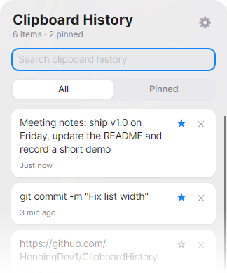

The first public release of **Clipboard History**, a small, clean clipboard manager for Windows. It sits in your system tray, remembers everything you copy, and lets you find it again in a second.

## ✨ Features
- **Remembers what you copy:** every piece of text you copy is saved automatically
- **One click to copy again:** click an item and it's back on your clipboard
- **Instant search** across your whole history
- **Pinned snippets** stay at the top and are never cleared
- **Copy times:** see when each item was copied ("Just now", "5 min ago", "Yesterday 09:10")
- **Light and dark mode** with six accent colours
- **`Ctrl+Shift+V`** opens it from anywhere. `Enter` copies the top result and `Esc` closes it
- **Private:** works fully offline, with no account and no telemetry

## 📥 Which file do I download?
| File | What it is |
|---|---|
| **ClipboardHistorySetup.exe** | **Recommended.** Installs the app for your user (no admin rights), adds it to the Start Menu and Windows search, can start it with Windows, and adds an uninstaller in Settings → Apps. |
| **ClipboardHistory.exe** | Portable version: just run it, nothing is installed. |

## 💻 Requirements
Windows 10 or 11 (64-bit). Nothing else is needed: the .NET runtime is included.

## ⚠️ Note
The app isn't code-signed yet, so Windows SmartScreen may warn you the first time you run it. Click **More info → Run anyway**. Some antivirus programs may also flag new unsigned apps; the full source code is in this repository.
